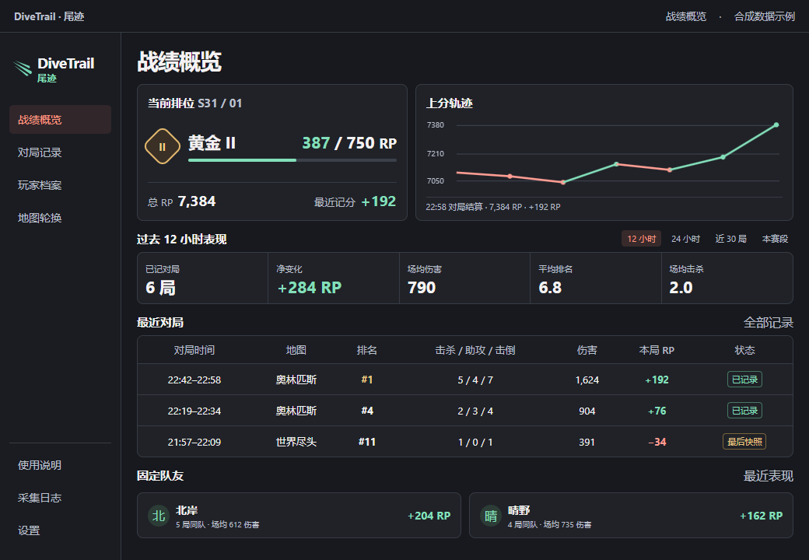
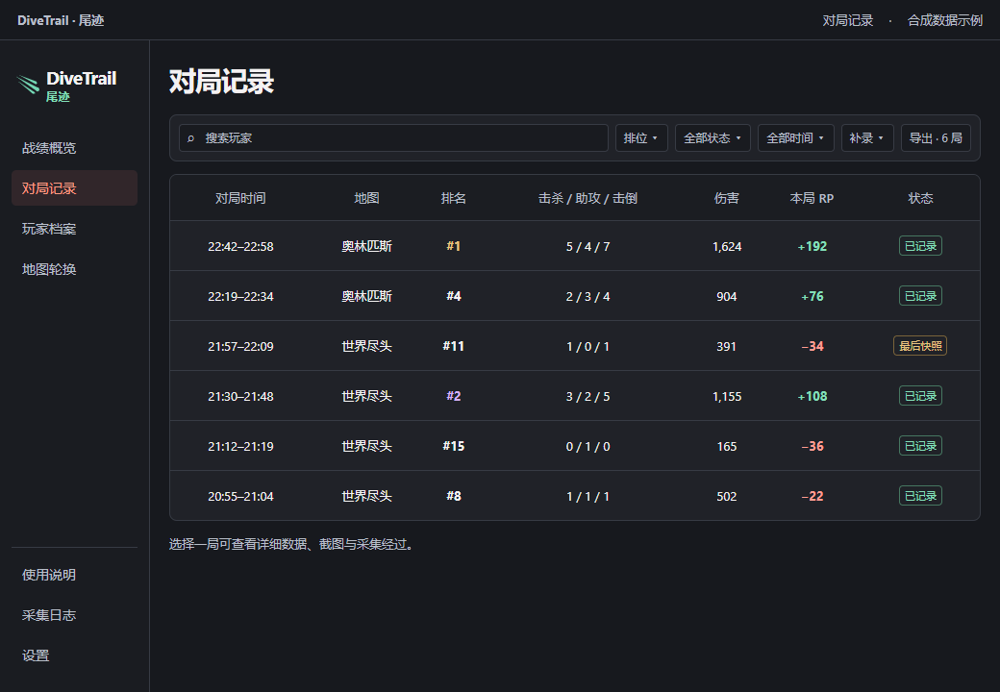
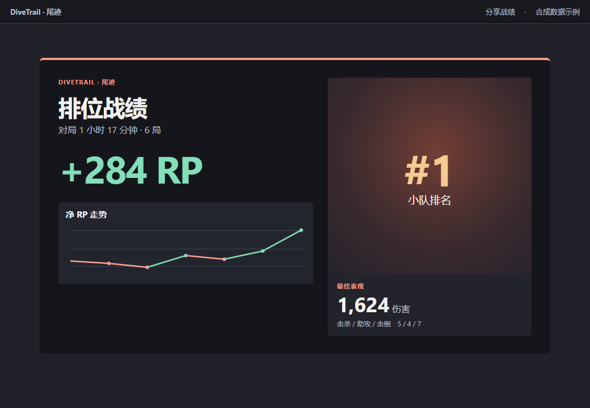

# DiveTrail · 尾迹

**Apex Legends match history and squad stats**

Windows 上的 Apex Legends 本地战绩工具。打完自动记下每局表现、排位加减分和固定队友，一晚打了多少局、分在哪几局涨跌，回头都能查。

[项目官网](https://neckozo.github.io/DiveTrail/) · [更新日志](CHANGELOG.md) · [提交问题](https://github.com/NeckoZo/DiveTrail/issues)

_界面示意使用合成数据。_

## 下载

| 版本 | 适用场景 | 下载 |
| --- | --- | --- |
| Windows x64 安装版 | 日常使用，从开始菜单启动 | [EXE 安装包](https://github.com/NeckoZo/DiveTrail/releases/download/v1.0.0/DiveTrail-1.0.0-setup-win-x64.exe) |
| Windows x64 便携版 | 解压试用，或让数据留在独立目录 | [ZIP 便携包](https://github.com/NeckoZo/DiveTrail/releases/download/v1.0.0/DiveTrail-1.0.0-portable-win-x64.zip) |

支持 Windows 10 / 11 x64。发行包自带 Python 和 OCR 模型。系统组件缺失时，按提示安装 [Microsoft Edge WebView2 Evergreen Runtime](https://developer.microsoft.com/microsoft-edge/webview2/) 或 [Visual C++ x64 Redistributable](https://learn.microsoft.com/cpp/windows/latest-supported-vc-redist)。校验值和版本变更见 [v1.0.0 Release](https://github.com/NeckoZo/DiveTrail/releases/tag/v1.0.0)。

## 三步开始

1. **打开尾迹。** 安装版从开始菜单打开。便携版先完整解压到可写目录，再运行目录里的程序。
2. **核对游戏昵称。** 首次使用按软件说明切到 Apex 排位大厅开始识别，也可以直接填写当前显示的游戏昵称。固定队友昵称可稍后在设置填写。
3. **正常打完一局。** 保持 Apex 在前台，打完后停留在总结和经验值分数页，让尾迹读取。想手动补拍时，在对应游戏页面按 `F8`。

总结读到和 RP 核验后可播放提示音。可在「设置 → 采集与音效」切换提示音、选择提醒时机，也可以暂停和继续记录。

## 你可以看什么

- **战绩概览。** 查看当前段位、总 RP 和上分轨迹。切换过去 12 小时、24 小时、近 30 局或本赛段。把指针移到轨迹点可查看该局分数。
- **对局记录。** 按时间、玩家、模式和状态筛选。点开一局可看排名、阵容、击杀、助攻、击倒、伤害和可用截图，也可修正、补录和导出。
- **局内快照。** 漏掉结算页时，尾迹会尝试使用本局最后可用的局内数据，并以「最后快照」标记。
- **固定队与英雄统计。** 选中自己或固定队友，查看英雄使用次数、场均伤害和最近同队表现。
- **地图轮换与分享卡。** 查看轮换地图和剩余时间，导出可隐藏玩家昵称的战绩卡。

| 对局记录示例 | 分享战绩示例 |
| --- | --- |
|  |  |

公开版不附带游戏美术或画面模板，保留结算和分数的文字识别。英雄头像与局内战斗计数仍可能留空；有三人总结时优先读取总结。托盘使用尾迹原创的小水怪吉祥物。

## 数据、反馈和升级

- **安装版数据。** 保存在 Windows「文档」中的 `DiveTrail` 文件夹。便携版数据保存在解压目录下的 `portable-data`。迁移前在设置导出 `.matchlog` 备份，再导入目标版本。
- **问题反馈。** 打开「采集日志」，填写遇到的问题，按需附上日志，点击提交。记下回执和大致对局时间。公开 Issue 里可以提供软件版本、Windows 版本、分辨率和缩放比例；请把游戏截图或详细诊断留给匿名反馈流程。详见[数据与隐私](PRIVACY.md)。
- **获取更新。** 版本号旁有更新时，打开更新说明选择对应的安装版或便携版。也可直接访问 [Releases](https://github.com/NeckoZo/DiveTrail/releases)。更新前建议在设置导出备份。

## 开发

从源码运行所需的 Python、依赖和 Windows 测试步骤见[开发指南](docs/DEVELOPMENT.md)。采集、识别和存储的模块边界见[架构说明](docs/ARCHITECTURE.md)，构建所用的资源和依赖各自适用的条款见[第三方素材与许可](THIRD_PARTY_NOTICES.md)。

问题报告请附操作步骤、预期和实际结果。提交修改前请阅读[贡献说明](CONTRIBUTING.md)。

## 许可

DiveTrail 自有代码使用 [MIT](LICENSE)。第三方依赖和素材适用其各自许可。

This project is not endorsed by or affiliated with EA or its licensors.
